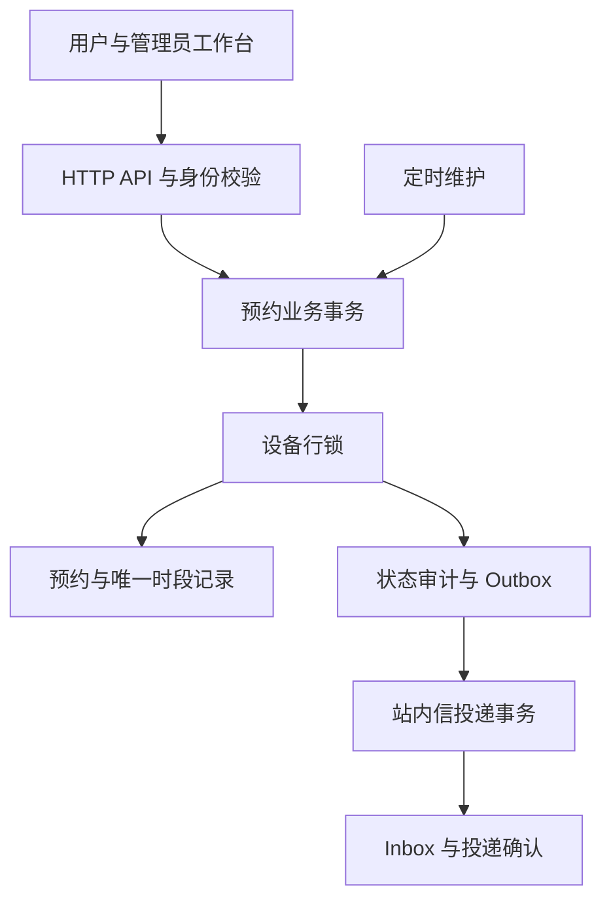
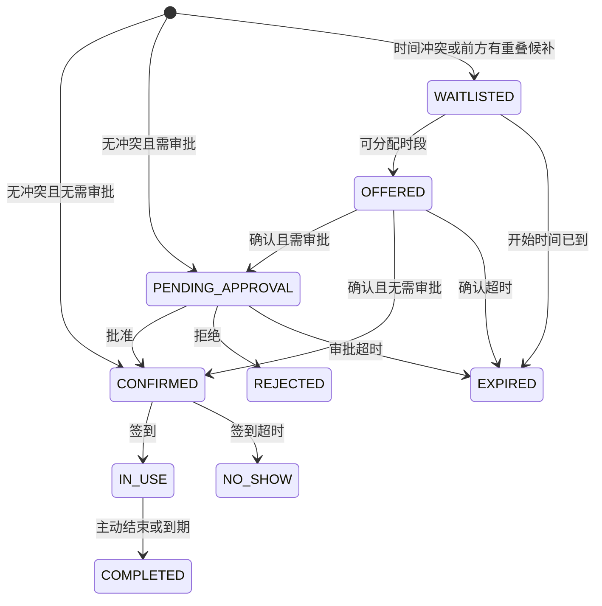

# 架构与设计取舍

## 分层

`ApiController` 负责输入和身份；`BookingService` 管理事务与状态；`Store` 管理数据访问；`Maintenance` 和 `OutboxDispatcher` 执行后台任务；`AuthService` 管理账号及可撤销会话。同源 HTML/CSS/JS 页面无需 Node 构建。

## 状态机

有效预约在规则允许时可以取消。设备停用取消所有未使用的有效预约和候补；培训撤销只作用于该用户、该设备。终态不能通过迟到审批等请求重新激活。

## 冲突与事务

一次 2 小时预约占用 4 条半小时 `reservation_slot`，主键 `(equipment_id,slot_at)` 保证数据库中没有重复占用。创建预约、创建停机及改期按“用户行→设备行”加锁；其他变更只锁设备行，不反向获取用户锁。使用 READ_COMMITTED，锁后重新读取状态。用户锁保证跨设备配额检查和同用户幂等键判定的一致性。

预约、时段、审计和事件同事务提交。唯一约束提供最终保护；设备行锁让冲突判断和候补选择一致。同设备写请求串行化，不同设备可并行。当前一次预约一台设备，不支持多设备原子预约。

## 候补公平性

候补按 ID 顺序处理。较早的长预约因部分区间被占而无法满足时，后来的重叠短预约也继续等待；不重叠的请求不受阻。这会牺牲部分利用率来减少长预约饥饿，是明确的产品取舍。

分配时先占时段再写 OFFERED，同事务提交。确认、取消、审批和超时都取得同一设备锁；重复调度不能重复分配或释放。候补起始时间已到就过期，不修改用户申请区间。

## 退出与恢复

数据库保存期限、状态和事件，不依赖进程内倒计时。启动后扫描即可继续处理。默认扫描间隔 5 秒，实际延迟还包含数据库等待与处理时间，不承诺严格 5 秒完成。

维护任务以设备ID为游标，每轮最多处理100台有候补、超时任务或到期维修的设备，循环推进避免低ID设备长期占据扫描批次。候补公平阻塞区间用合并有序区间维护，避免逐候补扫描整个前序队列；时隙占用和培训资格在设备锁内批量读取，减少逐候补查询。

通知使用独立500ms调度、每批最多100个事件；Spring调度池为2，避免设备维护阻塞通知。固定延迟从上一批完成后计算，实际吞吐仍取决于数据库和连接池；积压年龄通过管理员接口观测。

业务保存 Outbox；调度器逐事件调用 `OutboxDelivery`，在单事件事务内锁定事件、写 Inbox 并记录投递时间。失败单独记录重试次数和下一次时间，指数退避到最多300秒，五次失败后隔离，其他事件继续处理。管理员可查看失败事件并审计重试。Inbox 的 event_id 唯一。该机制只针对同库站内通知；外部 MQ / 邮件需另行设计接收方幂等。

## 维修与原子改期

维修占用 `reservation_slot` 的同一个主键空间；时隙行必须且只能绑定 reservation_id 或 block_id 之一。管理员不能静默覆盖已有预约/候补；创建冲突会返回409。维修到期由维护任务释放，取消操作幂等，设备审计保留变更原因。

改期仅支持本人已确认且未开始的预约，事务内取消原预约、释放其时隙、创建关联新预约和保存改期幂等记录。原单不改写日期，原始创建请求仍可按原参数重放。目标被占用、候补优先或任何写入失败时整笔事务回滚，原预约不受损；需审批的设备进入新一轮审批。

## 身份与时间

注册始终创建 USER；初始 ADMIN 由启动配置创建。密码使用 BCrypt，限制 UTF-8 72 字节。Token 为 256 位随机数，数据库只存 SHA-256 哈希，有效 12 小时，可退出撤销。

角色和预约归属由服务端检查。时段接口只返回占用时间和预约/维修类别，不暴露申请人、用途和预约 ID。API 响应携带 UTC 的 Z，数据库连接统一 UTC，页面转换本地时区。管理员运行指标通过 `/api/admin/operations` 访问，公共 Actuator 仍只开放 health。

登录失败限制为实例内辅助限制，集群级防护需要网关。H2 文件模式仅供单实例。自动完成代表软件预约时段结束，不能证明物理设备已停止运行；硬件门禁与设备控制尚未集成。
